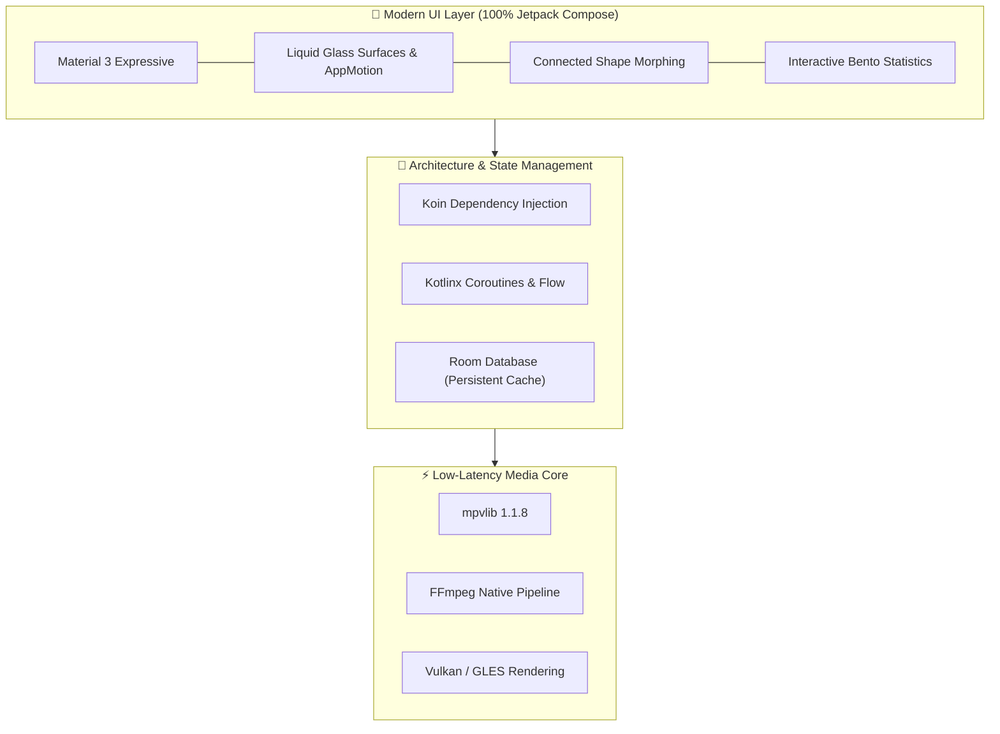

<div align="center">

<br>

# ⚡ V&M PLAYER ⚡
### *Next-Generation, Ultra-Lightweight Video & Audio Engine for Android*

[](https://github.com/Krishna1998/Video-Music-Player/releases)
[-3DDC84?style=for-the-badge&logo=android&logoColor=white)](https://developer.android.com)
[](https://arm.com)
[](https://mpv.io)
[](https://developer.android.com/jetpack/compose)
[](https://github.com)
[](https://github.com/Krishna1998/AIO-Player/actions/workflows/build.yml)

<p align="center">
  <b>Sleek. Minimalist. Uncompromisingly Fast.</b><br>
  Engineered with libmpv hardware-accelerated decoding, Vulkan shader pipelines, and a futuristic Jetpack Compose interface.
</p>

---

</div>

## 🌌 Overview

**V&M Player** is a next-generation media powerhouse built for pure playback performance. Stripped of bloatware, tracking telemetries, and heavy legacy libraries, it pairs the raw rendering muscle of **mpv** with an expressive **Material 3 / Fluid Shape** interface.

Whether decoding 4K HDR10+ anime with complex ASS karaoke subtitles or driving a 10-band spatial audio equalizer, V&M Player delivers ultra-low latency, featherweight RAM footprint, and battery-sipping efficiency.

---

## 🎛️ Active Feature Matrix

### 🎬 Visual & Playback Engine
| Feature | State | Description |
| :--- | :---: | :--- |
| **libmpv 1.1.8 Core** | 🟢 **ACTIVE** | Native FFmpeg/mpv decoding stack with full demuxer & codec coverage |
| **Hardware Acceleration** | 🟢 **ACTIVE** | `mediacodec` and `mediacodec-copy` with automated GPU recovery |
| **Vulkan Video Pipeline** | 🟢 **ACTIVE** | High-throughput Vulkan rasterizer with OpenGL ES fallback |
| **High-Precision Scalers** | 🟢 **ACTIVE** | Bilinear, Bicubic, Spline36, Lanczos, and EWA Lanczos shaders |
| **Dynamic Ambient Glow** | 🟢 **ACTIVE** | Real-time letterbox background glow sampled dynamically from video frames |
| **One UI 9.5 Wavy Visualizer** | 🟢 **ACTIVE** | **NEW:** 3-tier Aurora Frosted Glass Veil flowing live above the elapsed seekbar with real-time Bass, Mid, and Treble audio reactivity & beat pulse |
| **9 Premier Seekbar Styles** | 🟢 **ACTIVE** | **NEW:** Cyber Neon Laser, Frosted Capsule, Sonic Waveform, Liquid Mercury, Liquid Glass, Wavy, Thick, Slim, and Normal with live preference previews |
| **Battery Saver Mode** | 🟢 **ACTIVE** | Auto-drops to energy-efficient bilinear passes, limits CPU wakeups, and cuts GPU load when battery &le; 20% |
| **Pure Audio Mini Player** | 🟢 **ACTIVE** | Video playback cleanly finishes on back navigation; docked mini player is exclusively dedicated to music/audio |
| **Aspect-Preserving PiP** | 🟢 **ACTIVE** | True Picture-in-Picture with locked landscape ratio across queue advancements |

### 🎚️ Sound, Speed & Acoustics
| Feature | State | Description |
| :--- | :---: | :--- |
| **Graphic Equalizer** | 🟢 **ACTIVE** | Dual-mode tone controls (Bass / Treble) & multi-band graphical EQ |
| **Smart 'Jump Back In' Ranking** | 🟢 **ACTIVE** | **NEW:** Hero carousel prioritizes most listened songs based on playback history with clean, clutter-free artwork presentation |
| **Spatializer & Stereo Widening** | 🟢 **ACTIVE** | Low-latency algorithmic stereo expansion for headphones |
| **Playback Speed Persistence** | 🟢 **ACTIVE** | Granular speed control (0.25x – 4.0x) with state memory across tracks |
| **Ergonomic Speed Pill** | 🟢 **ACTIVE** | Playback speed button relocated to bottom action row for instant one-handed thumb access |
| **Dynamic Range Compression** | 🟢 **ACTIVE** | Tames explosive volume spikes in movies while boosting subtle whispers |
| **Volume Boost Cap** | 🟢 **ACTIVE** | Clean digital pre-amplification boost up to +30 dB |
| **Configurable Volume Step** | 🟢 **ACTIVE** | Discrete volume step multiplier (1 to 10 steps per hardware key press) with proportional boost scaling |
| **Smart Sleep Timer** | 🟢 **ACTIVE** | Integrated into both Audio & Video player controls with active playback sync (ticks down only while music runs), gentle 5s audio fade-out, graceful crash-free app auto-close on completion, live countdown badge, "End of track" mode, and quick extensions |
| **Online Lyrics Providers** | 🟢 **ACTIVE** | 17 online lyrics databases (Apple Music TTML, Musixmatch, LRCLIB, KuGou, PaxSenix, YouTube, etc.) with word/line sync badges, individual provider toggles, and translation controls |
| **Pitch Correction** | 🟢 **ACTIVE** | Maintains natural harmonic pitch when speeding up or slowing down audio |

### 📊 Modern Bento Watch Analytics
| Feature | State | Description |
| :--- | :---: | :--- |
| **Interactive 7-Day Chart** | 🟢 **ACTIVE** | Click any weekday bar to reveal exact hours/minutes with animated morphing indicators |
| **Video vs Audio Split** | 🟢 **ACTIVE** | **NEW:** Dynamic category leaderboards: "Most watched" for video and "Most listened" for music listening |
| **Playback Session Counter** | 🟢 **ACTIVE** | Atomic session tracking with zero background telemetry leakage |
| **Privacy Reset** | 🟢 **ACTIVE** | Instant one-tap wipe of all historical playtime data |

### 🎨 Interface & Fluid Aesthetics
| Feature | State | Description |
| :--- | :---: | :--- |
| **Material 3 Expressive** | 🟢 **ACTIVE** | Full dynamic color integration, OLED pure black theme, and expressive typography |
| **Curated 10-Icon Elite Suite** | 🟢 **ACTIVE** | **NEW:** In-app icon switcher dedicated to 10 futuristic designs on Stealth Carbon: Aura Aperture (default), Stealth Shutter, Kilo-Hertz Monolith, Quantum Aperture, Liquid Acoustic Droplet, Horizon Aero Blades, Aura Aperture, Eclipse Halo (Cyan & Lime @ 75%), and Supersonic Split Arrow (@ 75%), with Android 12+ animated splash screens and Material You dynamic theming |
| **Fusion Media Architecture** | 🟢 **ACTIVE** | **NEW:** Unified Fusion media hub replacing legacy Bento navigation; includes configurable Movies / Videos and Music rails with sub-categories (All Music, Favorites, Playlists, Folders, Albums, Artists) and custom order prioritization |
| **6 Flagship App Themes** | 🟢 **ACTIVE** | **NEW:** Stealth Acid Lime, Deep Midnight, Hyper Crimson, Cyber Magenta, Quantum Violet, and Solar Gold theme presets |
| **Slimline HUD Sliders** | 🟢 **ACTIVE** | **NEW:** Ultra-sleek 36dp width brightness and volume vertical pills with 18dp iconography and tabular metrics |
| **Global Scrollbar Hide Toggle** | 🟢 **ACTIVE** | **NEW:** Dedicated toggle in Appearance preferences to completely hide the scrollbar across Home, Music, and all media lists |
| **Glass UI App Themes** | 🟢 **ACTIVE** | Cyber Prism, Rosso Prism, Nordic Glacial, Velvet Nebula, and Solar Amber theme engine with specular frosted glass styling |
| **Hardware-Accelerated Panels** | 🟢 **ACTIVE** | **NEW:** `graphicsLayer` optimized side and bottom panels for fluid 120Hz jitter-free slide transitions with real-time Liquid Glass |
| **Audio Player Liquid Glass** | 🟢 **ACTIVE** | **NEW:** Frosted translucent glass pods, specular top-lit gradient rims, and floating depth shadows across all audio controls |
| **Top Header Track Counter** | 🟢 **ACTIVE** | **NEW:** Track and chapter counter (`Track X / Y`) relocated to upper side inside top header bar beneath NOW PLAYING |
| **Material You Themed Icons** | 🟢 **ACTIVE** | Full monochrome silhouette vector layer matching Android 13+ dynamic system color palettes |
| **Seamless FAB Alignment** | 🟢 **ACTIVE** | Perfect 12dp floating clearance above active mini player in video folders, playlists, and file browsers |
| **Crimson Sonic Theme** | 🟢 **ACTIVE** | Dedicated built-in neon ruby pink & electric cyan color scheme |
| **System-Wide Liquid Glass** | 🟢 **ACTIVE** | Frosted translucent surfaces with specular rim highlights across dialogs, app bars, and bento cards |
| **Connected Shape Morphing** | 🟢 **ACTIVE** | Animated corner morphing (`rememberConnectedShape`) across button presses |
| **Glass Specular Badges** | 🟢 **ACTIVE** | Media duration and 4K/HDR badges enhanced with top-lit specular glass borders |
| **HUD Customization** | 🟢 **ACTIVE** | Adjustable button opacity (0–100%), seekbar opacity, and borderless player modes |
| **File Name Conceal** | 🟢 **ACTIVE** | Hide video title and status pills for an ultra-immersive cinema canvas |

---

## 🛡️ Streamlined for Zero Bloat

To maximize battery life and deliver instant startup speeds, the architecture was ruthlessly audited:

```
[ Legacy 80MB+ Players ] ───▶ [ V&M Player Engine ~25MB ]
```

* 🚫 **ZERO Analytics & Tracking:** Removed all `sh.measure` telemetry, OkHttp trackers, and tracking daemons.
* 🚫 **ZERO Google Play Services:** Completely eliminated Cast SDK and Google Play Service dependencies.
* 🚫 **ZERO Heavy Protocol Bloats:** Discarded legacy SMB/SFTP/FTP protocol stacks for modern, lightweight direct playback.
* 🚫 **Stripped 4.0MB Bundled Font:** Delegated to Android's zero-overhead system native `SansSerif` typography, shrinking app resources by >90%.
* 🚫 **Uncompressed Page-Aligned Native Packaging:** Eliminates duplicate `.so` native library extraction on Android 8+, halving device storage footprint.
* 🚫 **Native Subtitle Engine:** Uses Android's built-in `ZipInputStream` and pure Java streams instead of heavy native archive binaries (`libarchive.so`, `libmediainfo.so`).

---

## 🔮 Architecture Stack



---

## 🚀 Building from Source

### Prerequisites
* **Android Studio Ladybug / Meerkat** or **IntelliJ IDEA**
* **JDK 17** (Temurin / OpenJDK)
* **Android SDK** (API 26 to 37) + **NDK 27.3.13750724**
* **CMake 3.22.1**

### Build Commands

```powershell
# Clone the repository
git clone https://github.com/Krishna1998/AIO-Player.git
cd "Video-Music-Player"

# Build Debug APK
./gradlew assembleStandardDebug

# Build Preview APK (Debug-signed release package)
./gradlew assembleStandardPreview

# Build Production Release APK (Requires keystore configured)
./gradlew assembleStandardRelease
```

---

## 📦 Package Distribution

| Variant | Package Identity | Purpose |
| :--- | :--- | :--- |
| **Release Build** | `video.music.player` | Official production release signed with production key |
| **CI / Beta Build** | `video.music.player.beta` | Bleeding-edge continuous deployment builds |
| **Debug Build** | `video.music.player.debug` | Local developer inspection with live profiling |

---

<div align="center">

<sub>Crafted with passion for high-performance Android media playback.</sub><br>
<sub>Licensed under <b>AGPL-3.0</b>.</sub>

</div>
