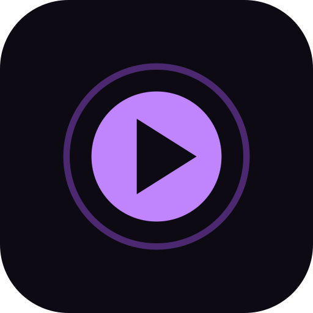
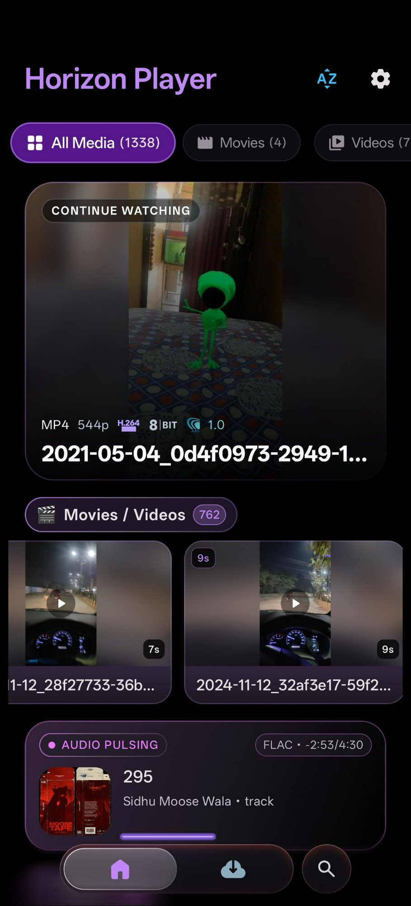
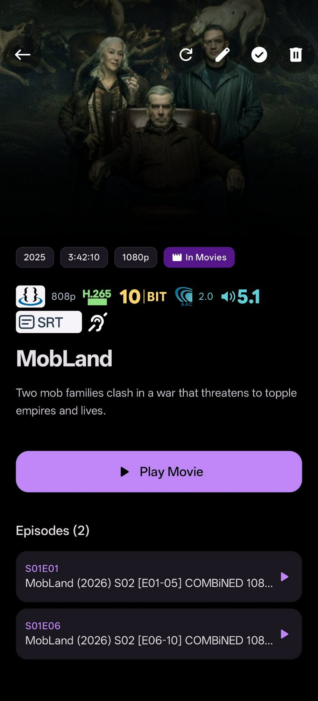
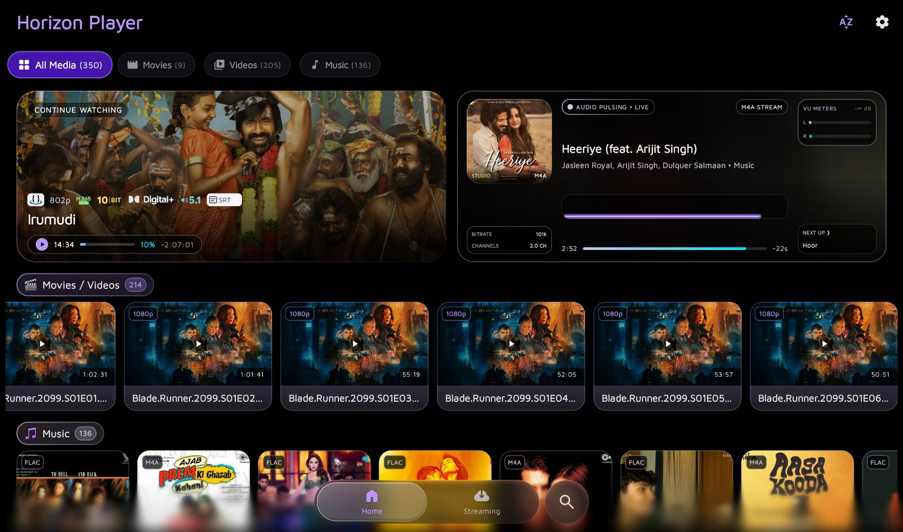
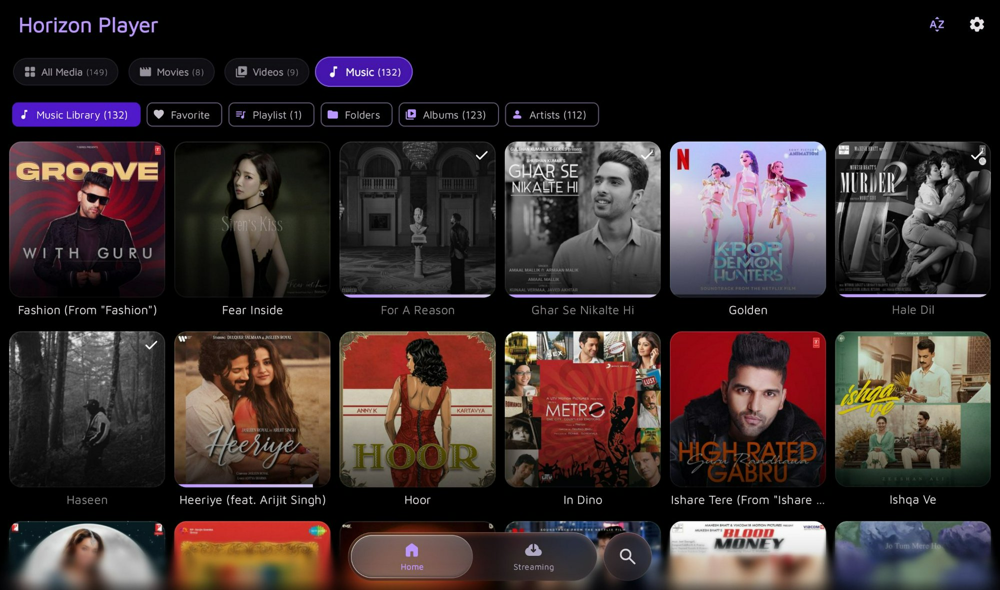
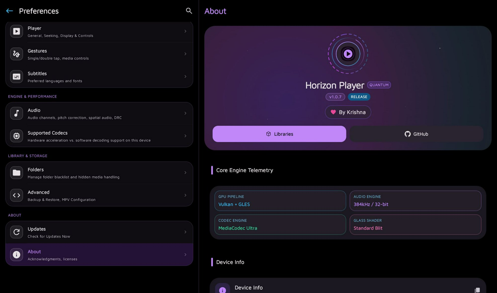

<div align="center">

<br>

# ✦ HORIZON PLAYER ✦

### `NEXT-GEN CINEMA • BIT-PERFECT HI-RES AUDIO • LIQUID GLASS`

[](https://github.com/Krishna1998/Horizon-Player/releases/latest)
[](https://github.com/Krishna1998/Horizon-Player/releases)
[](https://github.com/Krishna1998/Horizon-Player/stargazers)
[](https://github.com/Krishna1998/Horizon-Player/releases/latest)
[](https://mpv.io/)
[](LICENSE)

[Download APK](https://github.com/Krishna1998/Horizon-Player/releases/latest) • [Changelog](CHANGELOG.md)

</div>

---

## ⚡ Core Architecture

| Layer | Technology | Capability |
| :--- | :--- | :--- |
| **Video Engine** | `mpv` + `FFmpeg` | `HW+ Direct` decoding, 10-bit HDR, Anime4K shaders, portrait & landscape PiP |
| **Renderer** | `libplacebo` | High-precision tone-mapping, custom GLSL shaders & reference color accuracy |
| **Bit-Perfect Audio** | `Oboe C++` (Exclusive MMAP) | Bypasses Android AudioFlinger resampling for raw USB DAC lossless output |
| **Audiophile DSP** | `15-Band Parametric EQ` | Native C++ PEQ + searchable **AutoEQ** headphone & IEM catalog |
| **Interface** | `Material 3 Expressive` | Frosted **Liquid Glass**, OLED dark theme, dynamic ambient glow, 3-column tablet UI |
| **Privacy & Vault** | `Biometric Vault` | Hardware-backed Secure Folder lock, 100% offline, zero ads & zero telemetry |

---

## 📸 Visual Showcase

### 📱 Phone & Portrait Experience

| Home & Continue Watching | Music & Audio Pulsing | Hi-Res Audio Player |
| :---: | :---: | :---: |
|  |  |  |

| Real-Time Synced Lyrics | Movie Details & Episodes | Expressive Preferences |
| :---: | :---: | :---: |
|  |  |  |

---

### 🖥️ Tablet & Landscape Studio

<div align="center">
  <em>3-Column Audio Studio • Movies Hub • Video Folders • Music Library • Liquid Glass Appearance • Player & About</em>
</div>

<br>

| Home Hub | Movies & Series | Video Folders |
| :---: | :---: | :---: |
|  |  |  |

| Music Library | Appearance & Glass | 3-Column Audio Player |
| :---: | :---: | :---: |
|  |  |  |

| Movie Details | Pro Video Player | About & Engine |
| :---: | :---: | :---: |
|  |  |  |

---

## ✨ Feature Matrix

- **🎧 Bit-Perfect USB DAC & Signal Path:**
  - Exclusive AAudio/MMAP native C++ output (`horizonplayer_audio`) with automatic USB DAC detection.
  - Real-time **Signal Path** & hardware route inspection inside Audio Information and codec badges.
- **🎛️ 15-Band Parametric EQ & AutoEQ:**
  - Native C++ 15-band PEQ with target curve presets and online searchable headphone/IEM catalog.
- **🎵 Hi-Res Music & Synced Lyrics:**
  - 3-column tablet landscape player, waveform seekbar, Audio Pulsing spotlight, A-B loop, sleep timer, and embedded/online synced lyrics with translation.
- **🎬 Pro Video & Movies Hub:**
  - Automatic poster artwork, merged series episodes, watched checkmarks, and crisp SVG format badges (`MP4`, `H.265`, `AV1`, `10-BIT`, `5.1`, `SRT`).
- **🌐 Network & Media Servers:**
  - Stream directly from **Jellyfin**, **Audiobookshelf**, **Navidrome**, SMB/FTP/WebDAV, and custom URLs.
- **🔮 Liquid Glass & Customization:**
  - Customizable blur, wallpapers, OLED dark theme, squircle iconography, and gesture controls.
- **🛡️ 100% Private:**
  - Biometric Secure Folder, no ads, no tracking, no analytics.

---

## 🛠️ Build from Source

```bash
# Debug APK
./gradlew assembleStandardDebug

# Release APK
./gradlew assembleStandardRelease
```

---

## 📄 License

Licensed under **AGPL-3.0**. See [LICENSE](LICENSE) for details.
