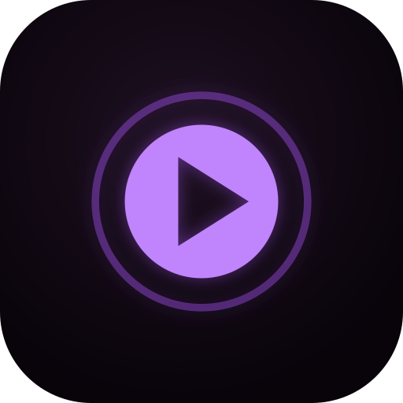

<div align="center">

<br>

# Horizon Player

**Lightweight, high-performance video & music player for Android.**  
Powered by the raw playback power of **mpv** and a modern **Material 3 / Liquid Glass** interface.

[](https://github.com/Krishna1998/Horizon-Player/releases)
[](https://developer.android.com)
[](https://mpv.io)
[](https://developer.android.com/jetpack/compose)
[](https://github.com)
[](https://github.com/Krishna1998/Horizon-Player/actions/workflows/build.yml)

</div>

---

## ✨ Features

### 🎬 Video Playback
- **mpv Native Core**: Full hardware decoding (`mediacodec`) and wide codec support via FFmpeg.
- **Crystal-Clear Subtitles**: Full styling support for ASS, SSA, SRT, and PGS karaoke subtitles.
- **Intuitive Gestures**: Smooth vertical swipes for brightness/volume and horizontal swipes for precise seeking.
- **Picture-in-Picture & Background Play**: Keep watching or listening seamlessly while multitasking, with automated pause on phone lock.
- **Selectable Volume & Brightness HUDs**: Choose between 6 futuristic designs (Dynamic Island, Hyper-Notch Matrix, Aero Dual-Tone, Soundstage, Segmented Blocks, and Classic Capsule) with enlarged high-visibility layouts and volume overboost indication.

### 🎵 Music & Audio
- **Lossless Audio**: Pristine playback for FLAC, ALAC, WAV, AAC, MP3, OPUS, and more.
- **Equalizer & Sound Tuning**: 10-band equalizer with Bass Boost, Treble, and spatial widening.
- **Live Wavy Seekbar & Visualizers**: Ultra-smooth animated waveform and One UI 9 wavy visuals.
- **Synchronized Lyrics**: Timed line-by-line and word-by-word lyrics from over 15 online providers.
- **Smart Sleep Timer**: Gentle audio fade-out (3s to 30s slider) directly in the timer sheet, granular HH:MM:SS countdown, and zero-bleed end-of-track synchronization.

### 🔮 Cinematic Horizon Design
- **Unified Media Browser**: Streamlined Cinematic Horizon layout with Hero spotlight cards, smooth horizontal media rails, and Continue Watching toggle.
- **Reorderable Music Tabs**: Easily organize All Songs, Favorites, Playlists, Folders, Albums, and Artists.
- **Liquid Bubble Glass Navigation**: Expressive floating capsule navigation bar with colorful dynamic icons and specular glass lighting.
- **Custom Wallpapers & Themes**: Customizable background wallpapers with ambient blur, pure AMOLED black, and curated color palettes.
- **Custom Launcher Icons**: 10 hand-crafted app icon designs with Material You dynamic color support.
- **Jitter-Free Navigation**: Hardware-accelerated panel transitions for silky-smooth 120Hz displays.

### 🛡️ 100% Private & Lightweight
- **Zero Tracking**: No analytics, telemetry, or background monitoring.
- **Zero Google Play Services**: Works standalone and fully offline.
- **Small Footprint**: Fast launch speed, minimal battery consumption, and light memory usage.

---

## 🛠️ Building

### Requirements
- **JDK 17**
- **Android SDK** (API 26+)
- **CMake 3.22.1** & Android NDK 27+

### Build APK

```bash
# Debug build
./gradlew assembleStandardDebug

# Release build
./gradlew assembleStandardRelease
```

---

<div align="center">

Licensed under **AGPL-3.0**

</div>
