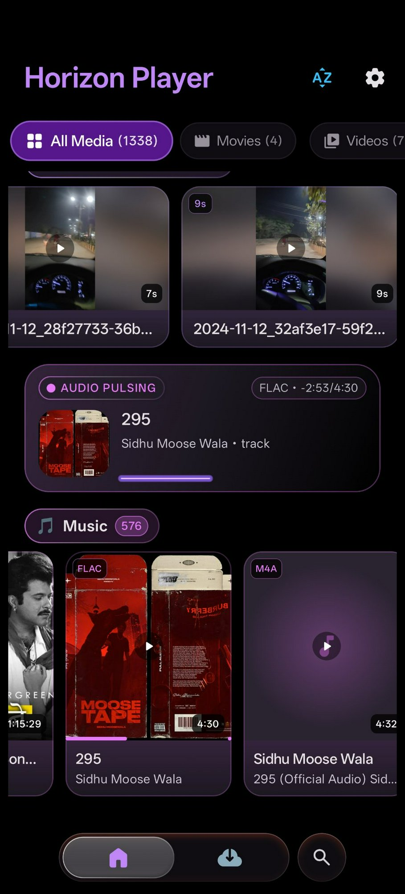
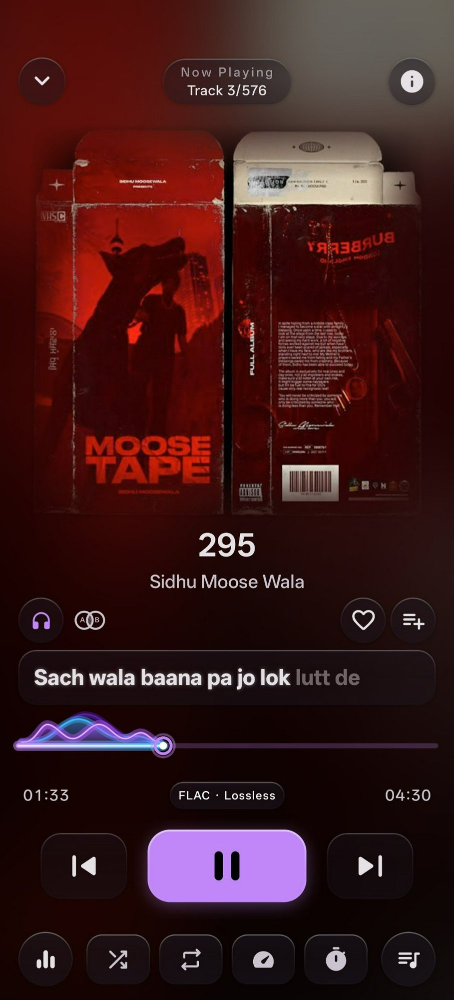
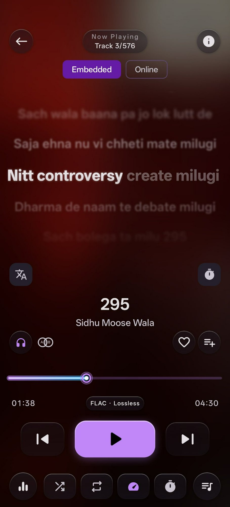
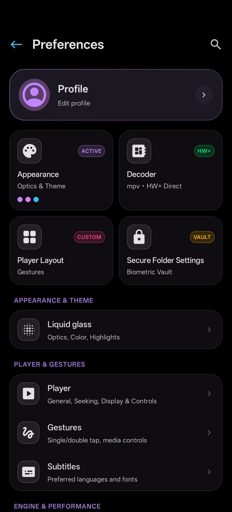

<div align="center">


# Horizon Player

**A private, offline-first Android video & Hi-Res music player powered by `mpv`, `FFmpeg`, and `libplacebo`, crafted with Material 3 Expressive Liquid Glass.**

[](https://github.com/Krishna1998/Horizon-Player/releases/latest)
[](https://github.com/Krishna1998/Horizon-Player/releases)
[](https://github.com/Krishna1998/Horizon-Player/stargazers)
[](https://github.com/Krishna1998/Horizon-Player/releases/latest)
[](https://mpv.io/)
[](https://krishna1998.github.io/Horizon-Player/)
[](LICENSE)

</div>

---

## 📸 Screenshots

| Home & Continue Watching | Music & Audio Pulsing | Audio Player |
| :---: | :---: | :---: |
|  |  |  |

| Synced Lyrics | Movie Details & Episodes | Preferences |
| :---: | :---: | :---: |
|  |  |  |

---

## ✨ Features

### 🎬 Pro Video Playback
- **mpv 0.42 + FFmpeg 9.1 + libplacebo:** Hardware-accelerated (`HW+ Direct`) playback with 10-bit HDR tone-mapping.
- **Smart Movies & Series Hub:** Automatic poster artwork, watch progress bars, merged series episodes, and direct resume.
- **SVG Format Badges:** Instant codec, resolution, bit-depth, audio channel, and subtitle badges (`MP4`, `H.265`, `AV1`, `10-BIT`, `5.1`, `SRT`).
- **Portrait & Landscape PiP:** Seamless Picture-in-Picture matching the video's orientation.

### 🎵 Hi-Res Music & Synced Lyrics
- **Lossless Audio:** Native support for `FLAC`, `ALAC`, `WAV`, `OPUS`, `AAC`, `AC3`, and `DTS` with SVG quality badges.
- **Audio Pulsing & Transport:** Expressive waveform seekbar, A-B loop, 10-band equalizer, sleep timer, and speed control.
- **Synced Lyrics:** Real-time embedded and online lyrics with fullscreen mode.

### 🔮 Liquid Glass & Privacy
- **Material 3 Expressive:** Frosted Liquid Glass optics, OLED dark theme, custom wallpapers, and configurable player layouts.
- **Biometric Secure Vault:** Lock private media folders behind fingerprint/biometric authentication.
- **100% Offline & Ad-Free:** Zero ads, zero tracking, zero telemetry.

---

## 🛠️ Building

### Requirements
- **JDK 17**
- **Android SDK** (API 26+)
- **CMake 3.22.1** & Android NDK 27+

### Build APK

```bash
# Debug build
./gradlew assembleStandardDebug

# Release build
./gradlew assembleStandardRelease
```

---

## 🙏 Credits

- **MPVEX**
- **MPVRX**
- **REX PLAYER**

---

<div align="center">

Licensed under **AGPL-3.0**

</div>
