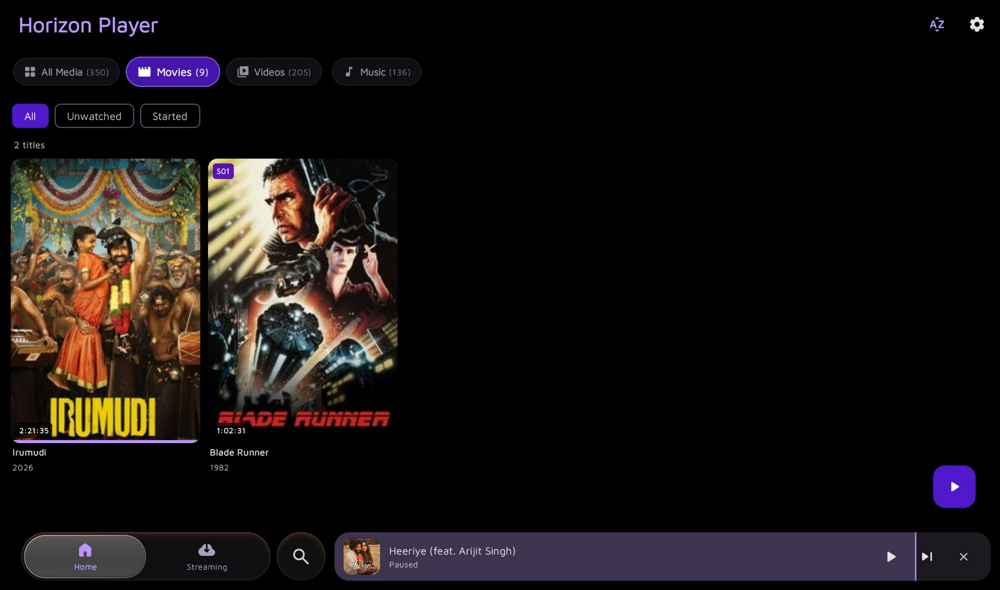
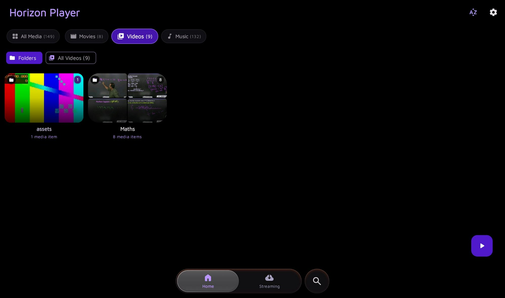
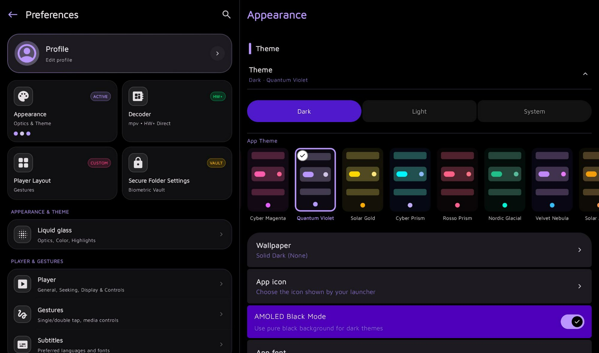
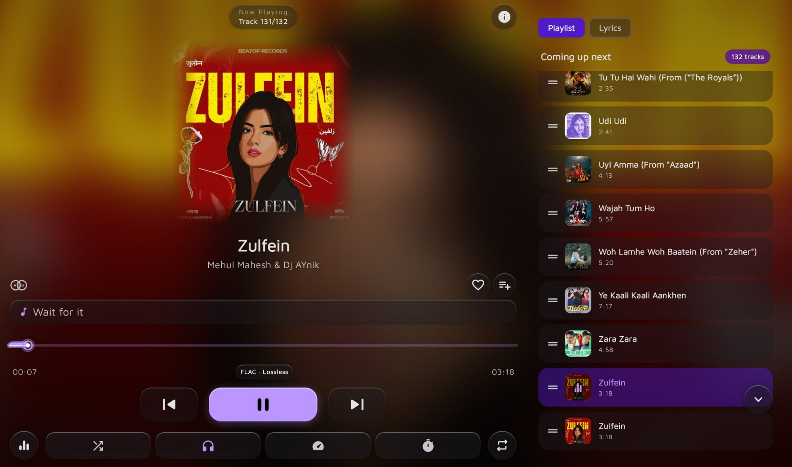
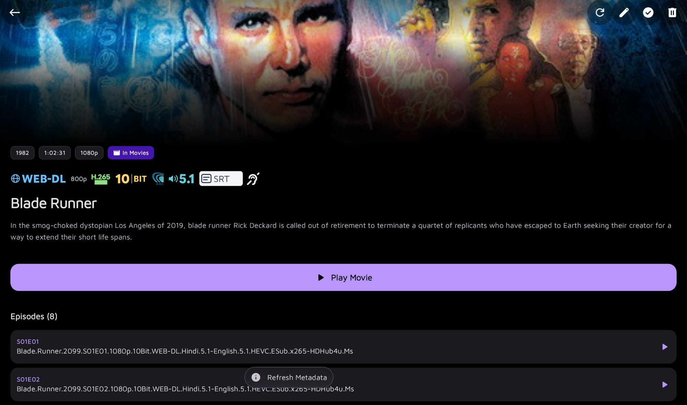
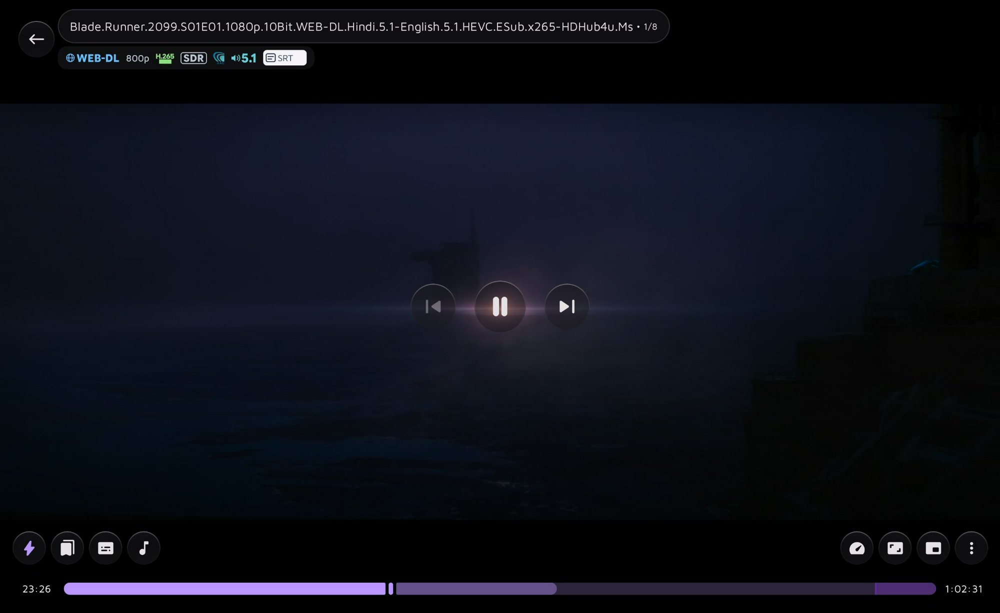

<div align="center">

<br>

# ✦ HORIZON PLAYER ✦

### `CINEMA & HI-RES AUDIO • LIQUID GLASS • 100% PRIVATE`

[](https://github.com/Krishna1998/Horizon-Player/releases/latest)
[](https://github.com/Krishna1998/Horizon-Player/releases)
[](https://github.com/Krishna1998/Horizon-Player/stargazers)
[](https://github.com/Krishna1998/Horizon-Player/releases/latest)
[](https://mpv.io/)
[](https://krishna1998.github.io/Horizon-Player/)
[](LICENSE)

[Website](https://krishna1998.github.io/Horizon-Player/) • [Download APK](https://github.com/Krishna1998/Horizon-Player/releases/latest) • [Changelog](CHANGELOG.md)

</div>

---

## ⚡ Core Architecture

| Layer | Technology | Capability |
| :--- | :--- | :--- |
| **Video Engine** | `mpv 0.42.0` + `FFmpeg 9.1` | `HW+ Direct` decoding, 10-bit HDR, portrait & landscape PiP |
| **Renderer** | `libplacebo 7.401.0` | High-precision tone-mapping, custom shaders & color accuracy |
| **Audio Engine** | Hi-Res & Lossless Pipeline | `FLAC`, `ALAC`, `WAV`, `OPUS`, `AAC`, `AC3`, `DTS` + 10-band EQ |
| **Interface** | `Material 3 Expressive` | Frosted **Liquid Glass**, OLED dark theme, dynamic ambient glow |
| **Security** | `Biometric Vault` | Hardware-backed Secure Folder lock, 100% offline & zero telemetry |

---

## 📸 Interface Showcase

| Home & Continue Watching | Music & Audio Pulsing | Audio Player |
| :---: | :---: | :---: |
|  |  |  |

| Synced Lyrics | Movie Details & Episodes | Preferences |
| :---: | :---: | :---: |
|  |  |  |

---

## ✨ Highlights

- **🎬 Pro Video & Movies Hub:** Automatic poster artwork, watch progress bars, merged series episodes, and crisp SVG format badges (`MP4`, `H.265`, `AV1`, `10-BIT`, `5.1`, `SRT`).
- **🎵 Hi-Res Music & Synced Lyrics:** Waveform seekbar, Audio Pulsing spotlight, SVG quality badges (`HI-RES`, `FLAC`, `DOLBY`), A-B loop, sleep timer, and real-time embedded/online lyrics.
- **🔮 Liquid Glass Optics:** Customizable blur, highlights, OLED dark theme, wallpapers, and player control layouts.
- **🛡️ 100% Private:** No ads, no tracking, no analytics.

---

## 🛠️ Build from Source

```bash
# Debug APK
./gradlew assembleStandardDebug

# Release APK (arm64-v8a)
./gradlew assembleStandardRelease
```

> **Requirements:** JDK 17 • Android SDK (API 26+) • CMake 3.22.1 • Android NDK 27+

---

## 🙏 Credits

- **MPVEX**
- **MPVRX**
- **REX PLAYER**

---

<div align="center">

**Horizon Player** • Licensed under **AGPL-3.0**

</div>


---

## 📸 Screenshots

<p align="center">
  
  
  
  
  
  
  
  
  
</p>
